# 🎯 TED Talks Recommender

[](https://python.org)
[](https://jupyter.org)
[](https://scikit-learn.org)
[](https://pandas.pydata.org)
[](https://numpy.org)
[](LICENSE)
[]()
[]()

> **A content-based recommendation engine for TED Talks** powered by TF-IDF vectorization and cosine similarity. Discover talks you'll love based on what you've already watched.

---

## 🌟 Overview

| Metric | Value |
|--------|-------|
| **Talks Processed** | 4,005 |
| **Vocabulary Size** | 366,288 terms |
| **Features** | Unigrams + Bigrams |
| **Similarity Metric** | Cosine Similarity |
| **Matrix Size** | 4005 × 4005 (dense) |
| **Language** | English |

### 🎬 Demo Preview

```text
🔍 Seed: "The best stats you've ever seen" (Hans Rosling)
━━━━━━━━━━━━━━━━━━━━━━━━━━━━━━━━━━━━━━━━━━━━
1. Hans Rosling — "Let my dataset change your mindset"     ████████████ 0.847
2. Hans Rosling — "Religions and babies"                    ████████████ 0.823
3. David McCandless — "The beauty of data visualization"    ███████████  0.791
4. David McCandless — "Information is beautiful"            ███████████  0.768
5. Gapminder — "The good news of the decade"               ██████████   0.742
```

---

## 🏗️ Architecture

```mermaid
graph LR
    A[📥 Raw Data<br/>ted_talks_en.csv] --> B[🔍 Exploration<br/>01_data_exploration]
    B --> C[📊 EDA & Quality<br/>02_eda_data_quality]
    C --> D[🧹 Cleaning & Preprocessing<br/>03_data_cleaning_preprocessing]
    D --> E[🔤 TF-IDF Vectorization<br/>04_tfidf_vectorization]
    E --> F[📐 Cosine Similarity<br/>4005×4005 Matrix]
    F --> G[🎯 Recommendation Engine<br/>Task 5: Streamlit App]
    
    style A fill:#ffebee,stroke:#c62828
    style B fill:#fff3e0,stroke:#ef6c00
    style C fill:#e8f5e9,stroke:#2e7d32
    style D fill:#e3f2fd,stroke:#1565c0
    style E fill:#f3e5f5,stroke:#7b1fa2
    style F fill:#fce4ec,stroke:#c2185b
    style G fill:#e0f2f1,stroke:#00695c
```



---

## 📦 Tech Stack

### Core Libraries

| Category | Libraries |
|----------|-----------|
| **Data Processing** | `pandas`, `numpy` |
| **Visualization** | `matplotlib`, `seaborn` |
| **ML/NLP** | `scikit-learn` (TF-IDF, Cosine Similarity) |
| **Serialization** | `joblib`, `scipy.sparse` |
| **Environment** | `jupyter`, `python 3.11+` |

### Pipeline Artifacts

```
data/
├── raw/
│   ├── ted_talks_en.csv           # 45 MB  - Original Kaggle dataset
│   └── ted_talks_selected.csv     # 43 MB  - 12 core columns
└── processed/
    ├── ted_talks_cleaned.csv      # 123 MB - Cleaned + derived features
    ├── ted_talks_cleaned_all.csv  # 165 MB - With original text audit
    ├── tfidf_matrix.npz           # 23 MB  - Sparse (4005, 366288)
    ├── cosine_sim.npy             # 128 MB - Dense (4005, 4005) float64
    └── tfidf_vectorizer.joblib    # 10 MB  - Fitted vectorizer
```

---

## 🔬 Data Pipeline

### 1️⃣ Exploration (`01_data_exploration.ipynb`)

- **Source**: [TED Ultimate Dataset](https://www.kaggle.com/datasets/miguelcorraljr/ted-ultimate-dataset/data) → `ted_talks_en.csv`
- **Shape**: 4,005 rows × 19 columns → **Selected**: 12 core columns
- **Key Finding**: 0 missing values, 0 duplicates, transcripts for ALL talks

### 2️⃣ EDA & Quality (`02_eda_data_quality.ipynb`)

| Check | Result |
|-------|--------|
| Missing `speaker_occupation` | 522 (13.03%) |
| Short transcripts (< 50 words) | 10 talks |
| Unique tags | 457 |
| Total tag mentions | 31,700 |
| Views distribution | Highly skewed (power law) |
| Transcript word count | Mean: ~2,400 words |

### 3️⃣ Cleaning & Preprocessing (`03_data_cleaning_preprocessing.ipynb`)

```python
# Text cleaning pipeline applied to: title, description, transcript, tags
def clean_text(text):
    text = text.lower()                              # 1. Lowercase
    text = remove_urls_and_html(text)                # 2. Remove URLs/HTML
    text = remove_ted_noise(text)                    # 3. Remove (laughter), (applause), etc.
    text = replace_punctuation_with_space(text)      # 4. Punctuation → space
    text = collapse_whitespace(text)                 # 5. Normalize whitespace
    return text
```

**Decisions**:
- Fill missing `speaker_occupation` → `"unknown"`
- Keep short transcripts + flag with `is_short_transcript`
- **Two combined text variants** created:
  - `combined_text` — plain concatenation
  - `combined_text_prefixed` — `title: … tags: … description: … transcript: …` ← **used for TF-IDF**

### 4️⃣ TF-IDF Vectorization (`04_tfidf_vectorization.ipynb`)

```python
vectorizer = TfidfVectorizer(
    stop_words="english",      # Remove common English stopwords
    ngram_range=(1, 2),        # Unigrams + bigrams
    min_df=2,                  # Ignore terms in < 2 documents
    max_df=0.9,                # Ignore terms in > 90% documents
    sublinear_tf=True          # Log-scale term frequencies
)

tfidf_matrix = vectorizer.fit_transform(df["combined_text_prefixed"])
cos_sim = cosine_similarity(tfidf_matrix)
np.fill_diagonal(cos_sim, 0)   # Remove self-similarity
```

**Results**:
- **Vocabulary**: 366,288 terms
- **Sparsity**: ~99.8% (efficient storage with `scipy.sparse`)
- **Top recommendations** validate well for clear-topic talks (climate, creativity, simplicity)

---

## 📈 Key Findings

### ✅ What Works Well

| Seed Talk | Top-5 Precision | Notes |
|-----------|----------------|-------|
| Climate Crisis (Al Gore) | **5/5** | Perfect thematic clustering |
| Creativity (Ken Robinson) | **2/2** | Finds his own sequels + education cluster |
| Simplicity (David Pogue) | **2/2** | Design/tech cluster + "simplicity" matches |

### ⚠️ Known Issues

| Issue | Impact | Planned Fix |
|-------|--------|-------------|
| Generic words drift (e.g., "rethink") | Education seed off-topic by rank 3 | Field weighting / IDF tuning |
| Person names overweighted | "Tipper" outranks topic | Remove proper nouns / NER filtering |
| Number tokens pollute vocab | Noisy features | `token_pattern` regex fix |
| Transcript dominates | Tags/title signal diluted | Weighted field combination |

---

## 🚀 Quick Start

### Prerequisites

```bash
Python 3.11+
```

### Installation

```bash
# Clone the repository
git clone https://github.com/yourusername/ted-talks-recommender.git
cd ted-talks-recommender

# Create virtual environment
python -m venv .venv
source .venv/bin/activate  # Windows: .venv\Scripts\activate

# Install dependencies
pip install -r requirements.txt
```

### Run Notebooks (in order)

```bash
jupyter lab notebooks/
# Execute sequentially:
# 01_data_exploration.ipynb
# 02_eda_data_quality.ipynb
# 03_data_cleaning_preprocessing.ipynb
# 04_tfidf_vectorization.ipynb
```

### Load Pre-trained Artifacts

```python
import joblib
import numpy as np
from scipy.sparse import load_npz
import pandas as pd

# Load artifacts
df = pd.read_csv("data/processed/ted_talks_cleaned.csv")
vectorizer = joblib.load("data/processed/tfidf_vectorizer.joblib")
tfidf_matrix = load_npz("data/processed/tfidf_matrix.npz")
cos_sim = np.load("data/processed/cosine_sim.npy")

# Get recommendations
def recommend(talk_id, top_k=5):
    idx = df[df.talk_id == talk_id].index[0]
    scores = cos_sim[idx]
    top_indices = scores.argsort()[-top_k-1:-1][::-1]
    return df.iloc[top_indices][["talk_id", "title", "speaker", "tags"]]

# Example
print(recommend(92))  # Hans Rosling's "Best stats" talk
```

---

## 📁 Project Structure

```text
ted-talks-recommender/
├── 📓 notebooks/
│   ├── 01_data_exploration.ipynb
│   ├── 02_eda_data_quality.ipynb
│   ├── 03_data_cleaning_preprocessing.ipynb
│   └── 04_tfidf_vectorization.ipynb
├── 📊 data/
│   ├── raw/
│   │   ├── ted_talks_en.csv
│   │   └── ted_talks_selected.csv
│   └── processed/
│       ├── ted_talks_cleaned.csv
│       ├── ted_talks_cleaned_all.csv
│       ├── tfidf_matrix.npz
│       ├── cosine_sim.npy
│       └── tfidf_vectorizer.joblib
├── ⚙️ .venv/
├── 📋 requirements.txt
├── 🚫 .gitignore
└── 📖 README.md
```

---

## 🗺️ Roadmap

### 🎯 Task 5: Recommendation Module (In Progress)
- [ ] Wrap `recommend()` into reusable Python module
- [ ] Implement **field-weighted TF-IDF** (tags ×3, title ×2, description ×1.5, transcript ×1)
- [ ] Add **diversity reranking** (MMR - Maximal Marginal Relevance)
- [ ] Evaluate on **20+ seed talks** with human judgment
- [ ] Build **Streamlit web app** with search & filters

### 🔮 Future Enhancements

| Priority | Feature | Description |
|----------|---------|-------------|
| 🔥 High | **Semantic Search** | Sentence-BERT embeddings for query understanding |
| 🔥 High | **User Feedback Loop** | Implicit/explicit feedback for personalization |
| 🟡 Medium | **Multi-language** | Extend beyond English-only talks |
| 🟡 Medium | **Hybrid Model** | Combine content-based + collaborative (if user data) |
| 🟢 Low | **Real-time API** | FastAPI service with caching |
| 🟢 Low | **Explainability** | Highlight matching phrases in recommendations |

---

## 📊 Evaluation Framework (Planned)

```python
# Metrics to track
metrics = {
    "precision_at_k": "Relevance of top-k recommendations",
    "diversity": "Intra-list diversity (1 - avg pairwise similarity)",
    "novelty": "How obscure/surprising are recommendations",
    "coverage": "% of catalog that can be recommended",
    "serendipity": "Unexpected but relevant recommendations"
}
```

---

## 🤝 Contributing

Contributions are welcome! Please read our [Contributing Guide](CONTRIBUTING.md) first.

```bash
# 1. Fork the repo
# 2. Create feature branch
git checkout -b feature/amazing-feature
# 3. Commit changes
git commit -m "Add amazing feature"
# 4. Push to branch
git push origin feature/amazing-feature
# 5. Open a Pull Request
```

### Development Setup

```bash
# Install dev dependencies
pip install -r requirements-dev.txt  # (to be created)

# Run tests
pytest tests/ -v

# Format code
black notebooks/ src/
isort notebooks/ src/
```

---

## 📄 License

This project is licensed under the **MIT License** - see the [LICENSE](LICENSE) file for details.

---

## 🙏 Acknowledgments

| Resource | Link |
|----------|------|
| **Dataset** | [TED Ultimate Dataset on Kaggle](https://www.kaggle.com/datasets/miguelcorraljr/ted-ultimate-dataset/data) |
| **TF-IDF Theory** | [scikit-learn Documentation](https://scikit-learn.org/stable/modules/feature_extraction.html#tfidf-term-weighting) |
| **Cosine Similarity** | [Wikipedia](https://en.wikipedia.org/wiki/Cosine_similarity) |
| **TED Talks** | [TED.com](https://www.ted.com/talks) |

---

## 📬 Contact

<p align="center">
  <a href="https://github.com/yourusername">
    
  </a>
  <a href="https://linkedin.com/in/yourusername">
    
  </a>
  <a href="mailto:your.email@example.com">
    
  </a>
</p>

---

<p align="center">
  <b>Made with ❤️ for TED enthusiasts everywhere</b><br>
  <sub>Star ⭐ this repo if you found it helpful!</sub>
</p>

<!-- 
  Badge references:
  https://shields.io/
  https://github.com/Ileriayo/markdown-badges
-->
